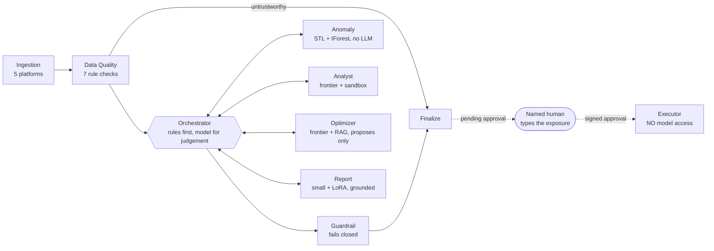

# AdIntel — Enterprise-Governed Agentic AI for Paid-Ad Intelligence

AdIntel is a team of AI agents that watches paid-ad performance for a marketing agency every night,
spots problems, works out why they happened, suggests fixes, and writes the client report.
**A human must approve anything that would spend client money.**

This repository is a **local-first, production-shaped** implementation. It runs on one Mac with two
models served by `mlx-lm`, and promotes to AWS by changing configuration, not code.

| | Local (this repo) | Production (documented path) |
|-|-------------------|------------------------------|
| Judgement tier | **Qwen3.8-27B-8bit** on `mlx_lm.server` :8081 | Frontier model on Amazon Bedrock |
| Volume tier (+ report adapter, safety classifier) | **Qwen3.6-35B-A3B-4bit** on `mlx_lm.server` :8080 | SageMaker / Bedrock (+ LoRA, Llama Guard) |
| Data + vectors | MongoDB Atlas Local (or in-memory) | MongoDB Atlas over PrivateLink |
| Queues / cache | Redis (or in-memory) | SQS (FIFO for executions) / ElastiCache |
| Services | 4 local processes or Docker Compose | ECS Fargate with per-service IAM roles |
| Observability | Langfuse, Jaeger, Prometheus, Grafana, Alertmanager | Langfuse in VPC, X-Ray, CloudWatch, Grafana, PagerDuty |
| Identity | Keycloak (OIDC, PKCE) or dev login | Cognito / Entra ID / Okta (OIDC) |
| Audit archive | Read-only files + MinIO Object Lock | S3 Object Lock, compliance mode, 7 years |
| Ad data | Synthetic worlds or your CSV exports | Live platform APIs (read scopes; writes only in the executor) |

## 30-second demo (no Docker, no models)

```bash
make venv install
ADINTEL_LLM_PROVIDER=mock .venv/bin/adintel demo
```

```
=== Urban Roast Coffee: awaiting_approval  (12 steps)    full investigation → $200/day budget shift pending approval
=== Fitely Activewear: completed  (8 steps)              nothing material → straight to report
=== NorthPeak Outdoor: aborted_data_quality  (2 steps)   ✋ conversions exactly 0 for 6 days → humans paged, no report
```

Three brands, one night, three different paths — including the path of deliberately **stopping**.

## Run it for real

Follow **[docs/13-setup/local-setup.md](docs/13-setup/local-setup.md)** (step by step): serve your two models
(`make mlx-small`, `make mlx-frontier`), start the infrastructure (`make up`), seed data, run the four
services and the Angular app, then walk through an approval end to end.

## What's inside



- **9 agents + 1 deliberately dumb executor**, LangGraph supervisor pattern (`src/adintel/agents`, `graph`).
- **Harness:** budget guard (25 steps / 400k tokens / $2 / 900 s), kill switches at 4 levels, idempotency,
  per-step checkpoints with resume, nested timeouts, the 21-row degradation matrix (`src/adintel/harness`).
- **Validation wrapper** around every model call: schema, repair ×2, retry with jitter, fallback chain,
  PII redaction, untrusted fencing, prompt/response hashing (`src/adintel/llm/gateway.py`).
- **RAG:** semantic chunking, hybrid vector + BM25 with RRF, mandatory tenant pre-filter, reranking,
  numeric grounding (`src/adintel/rag`).
- **Governance:** L2 autonomy, approval matrix with 7 server-side checks, four-eyes, signed approvals,
  hash-chained audit log, model & prompt registries with pinning (`src/adintel/approvals`, `audit`, `config/`, `prompts/`).
- **Security:** three-layer tenant isolation, process-scoped secrets, sandboxed analyst code, CSP, threat
  model with 13 threats (`docs/04-security`).
- **Evaluation:** 10 suites, ~1,100 golden cases, hard 100% gates on safety and money, LLM-judge with a
  variance band, promotion gate with cost ±15% (`src/adintel/evals`, `evals/`).
- **Testing:** unit, API, end-to-end, chaos, architecture-fitness, integration and k6 load tests (`tests/`).
- **Fine-tuning:** LoRA on the 4-bit base with `mlx_lm.lora`, signed and hash-pinned adapters (`finetune/`).
- **Angular 18 UI:** live run timeline, explainability trace, approval screen, streaming chat, governance console (`frontend/`).
- **Enterprise identity:** OIDC/JWKS verification (Keycloak locally, Cognito in prod), PKCE sign-in, least-privilege
  role intersection (`security/auth.py`, `deploy/keycloak/`).
- **Learning loop:** 14-day outcome tracking (actual vs predicted), per-tenant/brand feature flags, weekly triage
  page (`feedback/`, `harness/flags.py`).
- **Data lifecycle:** retention purge with legal hold, data-subject export/erasure, tenant offboarding, write-once
  audit archive (MinIO Object Lock locally), backups with restore drills, forward-only migrations
  (`privacy/`, `audit/archive.py`, `ops/`, `storage/migrations/`).
- **Local alternatives:** bring-your-own-data CSV connector with manual execution; Ollama / LM Studio / llama.cpp /
  vLLM profiles; per-tone report adapters (`connectors/csv_files.py`, `config/model-profiles.yaml`).
- **Production path:** Terraform for AWS, GitHub Actions CI/CD with blue/green and auto-rollback, migrations as a
  one-off task, SBOMs and secret scanning (`infra/`, `.github/`). Readiness:
  [production-readiness matrix](docs/14-production/production-readiness-matrix.md).

## Quality gates

```bash
make lint typecheck test-cov security evals gate
```

ruff · mypy --strict · ~260 tests (89% coverage, 85% gate) · bandit · 10 eval suites · promotion gate.

## Documentation

Start at **[docs/README.md](docs/README.md)**. Highlights:

| | |
|-|-|
| [What AdIntel is](docs/00-overview/what-is-adintel.md) | Business case, success criteria, the one-night story |
| [Architecture](docs/01-architecture/architecture.md) | Diagrams, harness, agents, models, RAG, data model, AWS↔local mapping |
| [Decisions](docs/02-decisions/README.md) | 25 ADRs, each with a revisit trigger |
| [Governance](docs/03-governance/governance.md) · [Security](docs/04-security/security.md) · [Safety](docs/05-safety/safety.md) | L2 autonomy, approvals, threat model, principles → code → tests |
| [Reliability](docs/06-reliability/reliability.md) · [Evaluation](docs/07-evaluation/evaluation.md) · [Testing](docs/08-testing/testing-strategy.md) · [Observability](docs/09-observability/observability.md) · [Audit](docs/10-audit/audit-and-reproducibility.md) · [Cost](docs/11-cost/cost-model.md) | How it stays correct, measured and explainable |
| [Runbooks & operations](docs/12-operations/runbooks.md) | P1 runbooks, cadence, DR |
| [Local setup](docs/13-setup/local-setup.md) · [Promotion to production](docs/14-production/promotion-to-production.md) | Step-by-step guides |
| [Changelog](CHANGELOG.md) | Every change, with a plain-English note in `docs/changelog/` |

## Principles

1. **Agents decide; code executes.** Any step with exactly one correct action is code, not an LLM call.
2. **No autonomous spending. Ever.** The component that can act has no model in it.
3. **Refuse rather than fabricate.** No analysis on untrustworthy data; every number traceable to the database.
4. **Degrade visibly, never fail silently.** Every gap is disclosed in the client report.
5. **Prove "reliably" with an eval, not intuition.**
