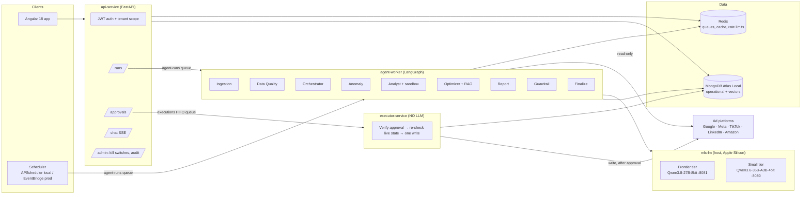
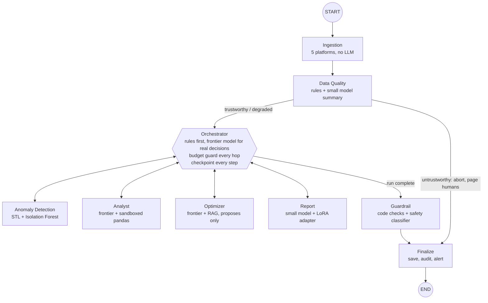

# AdIntel architecture

> **In plain words:** imagine an analyst team that never sleeps. A manager (the *Orchestrator*)
> looks at each brand's numbers and decides who needs to work on it tonight. A healthy brand just
> gets a report. A brand with a cost spike gets an investigation, a fix proposal and an urgent alert.
> A brand with broken tracking data gets nothing, because analysing broken data produces confidently
> wrong advice — so a human is called instead.

## 1. The three forces that shaped every decision

| Force | What it meant for the design |
|-------|------------------------------|
| **Variability** — every account behaves differently and the next step depends on what was just found | Agentic orchestration (LangGraph supervisor), not a fixed pipeline |
| **Scale with a long tail of routine work** — hundreds of reports a week | Tiered models: the strong model for judgement, the fast model (optionally fine-tuned) for volume |
| **Money and trust on the line** — recommendations move real budgets | RAG grounding, human approval gates, three-layer tenant isolation, immutable hash-chained audit log |

## 2. The design rule

> **Agents decide; code executes.** Any step with exactly one correct action is code, not an LLM call.

That rule is why ingestion, data-quality verdicts, anomaly detection, brand constraints, numeric
grounding and the action executor contain **no model at all**.

## 3. Logical view

The most important property is visible in the picture: **only the executor can spend money, and the
executor cannot call a model.** The agent worker reads everything but holds no write credentials,
so even a fully successful prompt injection cannot move a client's budget.

## 4. The agent graph (supervisor pattern)

- **Fixed start:** `START → Ingestion → Data Quality`. Hard-coded because there is exactly one
  correct first action.
- **Gate:** after Data Quality, a conditional edge either continues to the Orchestrator or aborts
  straight to Finalize.
- **Supervisor loop:** Anomaly, Analyst, Optimizer and Report each return to the Orchestrator,
  which picks the next hop. Specialists never call each other.
- **Fixed end:** `Guardrail → Finalize → END`. The guardrail cannot be skipped.

See [graph-and-harness.md](graph-and-harness.md) for the run lifecycle, budget guard,
checkpointing and idempotency.

## 5. Process view (what runs where, locally)

| Process | Command | Holds | Can call a model? | Can write to ad platforms? |
|---------|---------|-------|-------------------|----------------------------|
| `api-service` | `make run-api` | JWT verification key, approval signing key | Chat only | No |
| `agent-worker` | `make run-worker` | Read-only platform credentials | Yes | **No** |
| `executor-service` | `make run-executor` | Write credentials, approval verification key | **No** (enforced by a test) | Yes, with a valid approval |
| `scheduler` | `make run-scheduler` | Nothing sensitive | No | No |
| `mlx-lm` ×2 | `make mlx-small`, `make mlx-frontier` | Model weights | — | — |

Each process reads only the secrets it needs (see `docs/04-security/security.md`). In production
the same separation is enforced by IAM task roles.

## 6. Where to read next

| Topic | Document |
|-------|----------|
| How every AWS component maps to a local one | [aws-to-local-mapping.md](aws-to-local-mapping.md) |
| The nine agents and why their boundaries are where they are | [agent-team.md](agent-team.md) |
| Run lifecycle, budget guard, checkpoints, idempotency | [graph-and-harness.md](graph-and-harness.md) |
| Model tiers and the mlx-lm setup | [model-strategy.md](model-strategy.md) |
| RAG, vector search and the five kinds of memory | [rag-and-memory.md](rag-and-memory.md) |
| Collections, indexes and multi-tenancy | [data-model.md](data-model.md) |
| Every design decision with its revisit trigger | [../02-decisions/](../02-decisions/README.md) |
